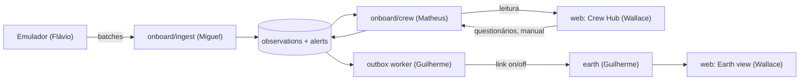

# Plano do hackathon — Astronaut Health Hub

**Prazo:** 1,5 dia. **Entrega:** pitch escrito + vídeo de 30 s.
**Equipe:** Flávio, Guilherme, Miguel, Matheus, Wallace.

## 1. O que vamos demonstrar

Um hub de saúde para uma tripulação de 4 astronautas, sem login (o tripulante é escolhido numa lista).

- Dados de wearable (emulador) e de outras fontes chegam a um serviço de bordo.
- O astronauta vê níveis atuais, tendências e desvios em relação à própria linha de base.
- O astronauta responde questionários e registra dados manuais.
- Regras locais geram alertas a bordo.
- Os dados sincronizam com a Terra, que tem um dashboard para o médico de voo.
- Quando o link com a Terra cai, nada para a bordo; ao voltar, a fila é drenada.

**O vídeo de 30 s define o escopo.** Só construímos o que aparece nele ou no pitch:

| Cena | ~Duração | O que precisa funcionar |
| --- | --- | --- |
| 1. Hub do astronauta: métricas e tendências vs. linha de base | 8 s | Ingestão + Crew API + dashboard |
| 2. Astronauta responde o check-in diário | 6 s | Questionários + entrada manual |
| 3. Cenário de febre/hipóxia dispara alerta a bordo | 6 s | Cenário no emulador + regra de alerta |
| 4. Link cai, fila cresce; link volta, Terra recebe | 10 s | Outbox + Earth service + Earth dashboard |

## 2. Decisão de arquitetura: tudo vira `observation`

Para o sistema ser modular, toda fonte de dados (wearable, questionário, entrada manual, integrações futuras) grava no mesmo formato.
O dashboard só lê `observations`, então uma fonte nova é só um adaptador novo.

```text
observation {
  id            uuid
  crewId        "crew-1" .. "crew-4"
  metric        id do catálogo (ex.: "heart_rate", "mood")
  value         number | null      # null = leitura inválida, nunca 0
  unit          string             # do catálogo
  source        "wearable" | "manual" | "questionnaire" | <futuro>
  sourceRef     id original (sampleId, responseId…)
  takenAt       epoch ms
}
```



## 3. Donos e fronteiras

Cada pessoa é dona de uma pasta. Mudanças na pasta de outra pessoa só com PR revisado pelo dono.

| Pessoa | Frente | Pasta | Entregas |
| --- | --- | --- | --- |
| Flávio | Emulador de wearable | `simulator/` | 4 dispositivos (1 por tripulante); métricas do catálogo; cenários `NORMAL`, `FEVER`, `HYPOXIA`, `POOR_SLEEP` trocáveis por config |
| Miguel | Ingestão de bordo | `onboard/app/ingest/` | `POST /v1/telemetry/batches` e cursor (contrato do Flávio); converte samples em `observations`; regras de alerta (limite absoluto + desvio da linha de base); grava eventos no `outbox` |
| Matheus | Crew API | `onboard/app/crew/`, `onboard/app/observations/` | Modelo `observation` (dono do schema); tripulação e linha de base (seed fixo); endpoints de leitura, tendência e z-score; questionários e entrada manual; `POST /v1/observations` genérico |
| Wallace | Frontend | `web/` | React + Vite + shadcn; rotas `/crew/:id` (hub) e `/earth` (médico de voo); funciona com mock até a API existir |
| Guilherme | Terra, sync e infra | `earth/`, `onboard/app/sync/`, `infra/` | VPS, docker-compose, proxy HTTPS; outbox worker + alternância do link; Earth service (ingestão idempotente + leitura); coordena pitch e vídeo |

Arquivos compartilhados, todos com dono:

| Arquivo | Dono | Regra |
| --- | --- | --- |
| `contracts/metrics.json` (catálogo de métricas) | Matheus | Congelado ao fim da Fase 0; mudanças só por PR avisado no grupo |
| `contracts/crew.json` (4 tripulantes + linha de base fixa) | Matheus | Idem |
| OpenAPI do onboard (gerado pelo FastAPI) | Matheus | Wallace gera os tipos TS a partir dele |
| Contrato simulador → bordo | Flávio | Miguel valida |
| Contrato bordo → Terra | Guilherme | Miguel grava no outbox nesse formato |
| `onboard/app/main.py`, `db.py` (montagem dos routers, conexão) | Guilherme | Criados na Fase 0; depois quase não mudam |
| Migrações SQL | Cada um no próprio arquivo | `001_observations.sql` (Matheus), `002_ingest.sql` (Miguel), `003_sync.sql` (Guilherme) |

## 4. Fluxo de trabalho

### Fase 0 — contratos (primeiras ~2 h, todos juntos)
1. Fechar o catálogo de métricas (subconjunto do doc de linha de base):
   - Wearable: `heart_rate`, `hrv_rmssd`, `spo2`, `resp_rate`, `skin_temp`, `sleep_duration`, `steps/activity`.
   - Manual: `body_mass`, `blood_pressure_sys/dia`, `water_intake`, `grip_strength`.
   - Questionário diário: `mood`, `stress`, `fatigue`, `sleepiness`, sintomas 0–10.
   - Questionário semanal: `phq4`, `team_climate`.
2. Fixar a linha de base dos 4 tripulantes (mediana e dispersão por métrica) em `contracts/crew.json`.
3. Guilherme sobe o esqueleto do repo: `docker-compose` com `onboard`, `earth`, `web`; FastAPI com routers vazios; README atualizado.
4. Matheus publica os modelos Pydantic e endpoints *stub* que devolvem fixtures. O OpenAPI sai automaticamente.
5. Wallace gera tipos (`openapi-typescript`) e mocks (MSW) a partir dele.

**Saída da Fase 0:** todos conseguem trabalhar sem esperar ninguém.

### Fase 1 — construção em paralelo (resto do dia 1)
Cada um na sua pasta, contra mocks e fixtures. PRs pequenos e frequentes na `main`.

**Checkpoint no fim do dia 1 (fatia fina ponta a ponta):** emulador → ingestão → `observations` → Crew API → um gráfico de FC no hub, rodando na VPS.

### Fase 2 — integração (manhã do dia 2)
- Trocar mocks por API real no front.
- Cenário de febre gera alerta, que aparece no hub.
- Outbox → Terra → Earth view; botão de link on/off.

### Fase 3 — congelamento e entrega (últimas ~5 h)
- **Code freeze** 5 h antes do prazo: só correções do que aparece no vídeo.
- Gravar o vídeo seguindo as 4 cenas acima. Gravar cedo, regravar se sobrar tempo.
- Pitch escrito: problema (riscos da NASA HRP) → solução → modularidade → próximos passos.

## 5. Regras da equipe

- Branch por pessoa/tarefa, PR curto, merge na `main` assim que funciona. Nada de branch longa.
- Contrato mudou → PR avisado no grupo antes do merge.
- Cada serviço sobe com `docker compose up`; quem quebrar a `main` conserta primeiro.
- Dados são sempre `SIMULATED`; nenhuma afirmação de validade clínica.

## 6. Diferenças em relação ao `readme.md` atual (atualizar na Fase 0)

- Backend em **Python/FastAPI**, não Node.js (o simulador na Vercel continua em TS).
- **4 dispositivos**, um por tripulante, em vez de 3.
- Frontend **entra** no escopo (hub + Earth view).
- Novo modelo genérico `observations` e endpoints de questionário e entrada manual.
- Fora do escopo, como já estava: BLE, MQTT, Protobuf, DELTA, PostgreSQL, login.
