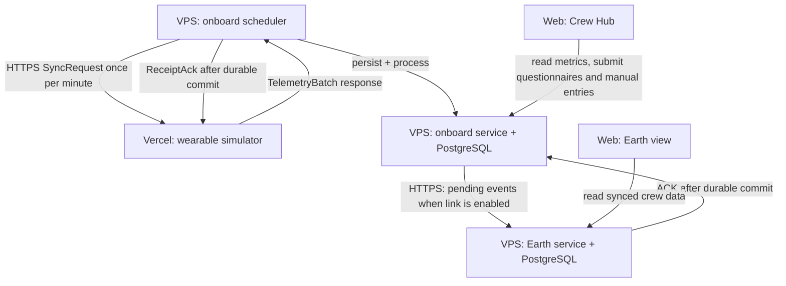

# Space Health Telemetry — Minimal MVP Flow

**Status:** MVP implementation standard  
**Scope:** Astronaut Health Hub for a 4-person crew — synthetic wearable telemetry, manual and questionnaire input, onboard processing and crew dashboard, and delivery to a simulated Earth service with a flight-surgeon view.

> **Team plan:** ownership, phases, and the 30-second demo script are in [docs/plan.md](./docs/plan.md).

> **MVP adaptation and integration baseline:** this document defines the reduced, integrable implementation that will be presented in the MVP. It is adapted from the broader architecture proposed in [../infra/telemetry.drawio](./infra/telemetry.drawio) and detailed in [../docs/telemetry-architecture.md](./docs/telemetry-architecture.md). It preserves the core guarantees—local durable ingestion, onboard processing, an outbox, automatic delivery, and durable acknowledgements—while intentionally replacing production-scale components with simpler MVP equivalents.

> The MVP is therefore **not** a replacement for the proposed telemetry architecture. It is a demonstrable integration path that validates its most important behaviors now and can evolve toward BLE, MQTT, Protobuf, DELTA/FULL reconstruction, and the other capabilities described in the infrastructure plan.

## 1. Goal

Build the smallest working, integrable system that demonstrates this flow:

1. Have the onboard service request telemetry from the wearable emulator for a crew of 4 astronauts.
2. Store and process them onboard, together with manual entries and questionnaire answers submitted by the astronauts.
3. Show each astronaut their current levels, trends, and deviations from their personal baseline in the Crew Hub.
4. Forward events to an Earth service when the simulated communication link is available.
5. Confirm durable reception, safely handle retransmission, and show the crew's data in the Earth view.

There is no physical wearable and no login in this MVP; the astronaut is picked from a crew list. The target wearable includes an onboard radiation sensor. The emulator uses historical ISS DosTel records to demonstrate that telemetry channel; they are not personal dose measurements. The onboard and Earth services run in separate Docker containers on the same VPS. Their separation is logical, not geographic.

### Modularity: everything becomes an `observation`

Every data source — wearable, questionnaire, manual entry, or a future integration — is converted into the same record. The Crew Hub and the trend logic read only observations, so adding a source means adding one adapter.

| Field | Purpose |
| --- | --- |
| id | Stable observation identity |
| crewId | `crew-1` … `crew-4` |
| metric | Metric ID from `contracts/metrics.json` (e.g. `heart_rate`, `mood`) |
| value | Number, or null for an invalid reading (never 0) |
| unit | Unit from the metric catalog |
| source | `wearable`, `manual`, `questionnaire`, or a future source name |
| sourceRef | Original identity (sample ID, response ID, …) |
| takenAt | Measurement time, epoch ms |

The metric catalog (`contracts/metrics.json`) and the crew list with fixed baseline values (`contracts/crew.json`) are the shared source of truth for metric IDs, units, and reference ranges.

## 2. Architecture



For the initial implementation, **use HTTP for both communication steps**. Do not add an MQTT broker yet. The onboard service initiates the wearable synchronization, just as the Edge does in the proposed BLE architecture; Vercel only emulates the wearable's response. HTTP is an MVP transport substitution for the BLE and MQTT transports proposed in `infra/telemetry.drawio`; durable storage, the receipt acknowledgement, the Outbox, and application ACK preserve the delivery behavior we need to demonstrate without another running component.

The simulator package implements the Vercel responder and includes a development-only onboard mock. The production onboard and Earth services described here still need to be implemented.

### Wearable emulator: current MVP behavior

The emulator in [`emu/`](./emu/) stands in for a physical wearable. It is passive: the onboard service initiates each synchronization request, and the emulator returns a bounded `TelemetryBatch` as the wearable would. There is no physical sensor or device connection in this MVP.

For every `POST /api/sync`, the emulator queries four public NASA data sources: historical actigraphy/sleep records, ISS DosTel radiation observations, and two exercise-test files. These external requests are part of the MVP data flow. If a source is unavailable or its response cannot be parsed, that source falls back to the checked-in NASA snapshot, and the response identifies whether each source was live or came from a bundled snapshot.

The returned reading deliberately combines NASA evidence with mock wearable fields:

| Data in the response | Current behavior |
| --- | --- |
| Sleep | Historical NASA context, not a current crew measurement. The Crew Hub UI is the planned input path for current sleep duration. |
| Radiation | The target wearable has an integrated radiation sensor. The MVP emulator uses historical NASA ISS DosTel observations as demonstration input for its radiation channel; these are environmental references, not a personal dose measurement. |
| Exercise heart rate | In `NASA_EXERCISE_REPLAY`, derived by interpolating NASA exercise-test checkpoints, followed by an emulator-calculated recovery. Other scenarios use simulated heart rate. |
| SpO₂, body temperature, and battery | Deterministically generated mock values in every scenario. |
| Acquisition timeline, device identity, and sample IDs | Generated by the emulator for the simulated wearable session. |

All telemetry is therefore demo data, even when some fields are based on NASA source records. NASA data is historical and is not a live feed from the crew or the ISS. The emulator is an MVP integration component, not a production wearable, a clinical monitor, or a medically validated data source. See [`emu/README.md`](./emu/README.md) for the API contract, source links, fallback behavior, and field-level provenance.

`hrv_rmssd`, `resp_rate`, `sleep_duration`, and `exercise_duration` remain classified as wearable metrics in the shared catalogs. The Crew Hub UI is their input path in this MVP because the emulator does not emit them yet; UI-submitted observations retain `source=manual` until device telemetry supplies them. Onboard aligns those UI entries with wearable batches by crew identity and timestamp, creating a richer chronological per-crew trace.

## 3. Minimum Components

| Component | Runs on | Responsibility |
| --- | --- | --- |
| Onboard scheduler | Onboard service container on VPS | Start each wearable synchronization window |
| Wearable simulator | Vercel, Node.js/TypeScript | Respond to `SyncRequest` with one deterministic bounded batch (4 devices, one per astronaut); validate `ReceiptAck` |
| Onboard service | VPS, Docker, Python/FastAPI | Request readings, convert them to observations, evaluate simple rules, serve the Crew API (trends, baselines, questionnaires, manual entries), and forward pending events |
| Onboard database | PostgreSQL 17 container (`onboard-db`) with its own volume; schema by Alembic | Store sessions, readings, observations, questionnaire responses, alerts, and Outbox records |
| Earth service | VPS, Docker, Python/FastAPI | Deduplicate and persist incoming events, return an ACK, and serve read endpoints for the Earth view |
| Earth database | Separate PostgreSQL 17 container (`earth-db`) with its own volume; schema by Alembic | Store received events and reception timestamps |
| Web app | VPS, Docker, React + Vite + shadcn/ui (TypeScript) | Crew Hub (`/crew/:id`) and Earth view (`/earth`); UI in English |
| Simulator HTTPS endpoint | Vercel | Expose authenticated simulator synchronization endpoints to the VPS |
| Web HTTPS entry point | Existing VPS proxy or one small reverse proxy | Serve the web app and the read/input APIs it calls |

Use three application containers (onboard, earth, web) and persistent volumes for the two databases. The onboard service calls the public Vercel endpoint over HTTPS. Earth ingestion stays on the private Docker network; only its read endpoints are exposed to the web app.

Redis, MQTT, Kubernetes, login, and a separate worker service are not required for this MVP.

### Repository layout and ownership

| Path | Owner | Contents |
| --- | --- | --- |
| `emu/` | Flávio | Wearable emulator on Vercel and its scenarios |
| `onboard/app/ingest/`, `onboard/migrations/versions/ingest/` | Miguel | Sync with the emulator, cursor, sample → observation conversion, alert rules |
| `onboard/app/crew/`, `onboard/app/observations/`, `onboard/migrations/versions/observations/` | Matheus | Observation model, crew and baselines, trends, questionnaires, manual entries |
| `onboard/app/sync/`, `onboard/migrations/versions/sync/`, `earth/` | Guilherme | Outbox worker, link toggle, Earth service and its migrations |
| `onboard/app/main.py`, `onboard/app/config.py`, `onboard/alembic.ini`, `common/`, `docker-compose.yml`, `infra/` | Guilherme | App wiring, shared database/migration/health code, Docker Compose, VPS deploy |
| `web/` | Wallace | Crew Hub and Earth view |
| `contracts/` | Matheus (metrics, crew), Flávio (`SyncRequest` / `TelemetryBatch` / `ReceiptAck`), Guilherme (onboard → Earth) | Shared contracts; changed only through an announced PR |

### Running locally

Everything (onboard, Earth, web) with Docker:

```bash
cp .env.example .env
docker compose up --build
```

| URL | What |
| --- | --- |
| http://localhost:8080 | Web app (Crew Hub at `/crew/:crewId`, Earth view at `/earth`) |
| http://localhost:8001/docs | Onboard API, direct (bound to 127.0.0.1) |
| http://localhost:8002/docs | Earth API, direct (bound to 127.0.0.1) |
| `localhost:5433` / `localhost:5434` | Onboard / Earth PostgreSQL (bound to 127.0.0.1; users `onboard` / `earth`) |

The web container proxies `/api/onboard/*` to onboard and only `/api/earth/health` and `/api/earth/v1/views/*` to Earth; Earth ingest stays private. `docker compose down -v` deletes both databases.

Developing one piece without Docker:

| Piece | Setup | Run | Test |
| --- | --- | --- | --- |
| Python services | `uv sync --all-packages` (once, in this folder) and `docker compose up -d onboard-db earth-db` | `cd onboard && uv run alembic upgrade heads && uv run uvicorn app.main:app --reload --port 8001` (Earth: `cd earth`, port 8002) | `cd onboard && uv run pytest` (also in `earth/` and `common/`; no database needed) |
| Web | `cd web && npm install` | `npm run dev` (proxies `/api/*` to ports 8001/8002) | `npm test`, `npm run typecheck` |
| Contracts | — | — | `python3 -m unittest discover -s contracts/tests` |

### Databases and migrations

Onboard and Earth each have their own PostgreSQL. Their schema changes only through Alembic migrations; the containers run `alembic upgrade heads` before starting the API.

| Service | Migrations | Branches |
| --- | --- | --- |
| onboard | `onboard/migrations/versions/<branch>/` | One per owner: `observations` (Matheus), `ingest` (Miguel), `sync` (Guilherme) |
| earth | `earth/migrations/versions/` | Single linear branch (Guilherme) |

Onboard's per-owner branches let three people add migrations at the same time without conflicting heads. How to create one, apply them, and depend on another branch's tables: [onboard/migrations/README.md](onboard/migrations/README.md).

Shared Python code lives in `common/` (`hub_common`): `create_database_engine`, the `DatabaseConnection` endpoint dependency (one transaction per request), `build_service_app`, the Alembic environment, and the `/health` router. Format Python with `uv run ruff format`.

## 4. Step-by-Step Flow

### Step 1 — Start a wearable synchronization window

The lightweight scheduler inside the onboard service runs once per minute and calls:

```http
POST https://<vercel-domain>/api/sync
Authorization: Bearer <SIMULATOR_TOKEN>
Content-Type: application/json
```

The `SyncRequest` identifies the simulation session, the next requested sequence (or cursor) for each device, a bounded maximum batch size, and the simulated time boundary. The onboard scheduler derives these values from its durable session state. The simulator rejects unauthorized or invalid requests and performs no generation when disabled.

### Step 2 — Generate and return a bounded batch

The simulator generates readings deterministically from the `SyncRequest` cursor and time boundary, subject to the configured batch limit, and returns a `TelemetryBatch` in the HTTP response. Vercel stores no persistent session state and does not call the VPS. The onboard database is the source of truth for cursor advancement.

Initial configuration:

| Setting | Initial value |
| --- | --- |
| Simulated devices | 4 (one per astronaut, `crew-1` … `crew-4`) |
| Sampling interval | 1 second per device |
| Onboard synchronization interval | 1 minute |
| Maximum simulated seconds per invocation | 60 |
| Typical full-minute batch | 240 readings |
| Scenario | NORMAL |
| Data source label | SIMULATED |

All readings are generated immediately during the invocation. There is no one-second waiting loop.

Each reading contains a stable sample ID, device ID, boot/session identity, sequence, acquisition timestamp, sensor status, and health telemetry. The current mock sensor values include heart rate in BPM, SpO₂ in hundredths of a percent, temperature in hundredths of a degree Celsius, and battery voltage in millivolts. The target wearable also carries an onboard radiation sensor. In the MVP, its radiation channel is demonstrated with historical ISS DosTel reference values, not personal dose measurements. Invalid sensor metrics are null, not zero. Each device is bound to one crew member, and the onboard service converts valid crew-health metrics into observations.

The same seed, session, configuration, device, and sequence produce the same reading. Configuration changes that affect generated data require a new session ID.

### Step 3 — Persist onboard and acknowledge

The onboard service:

1. Validates the simulator response contract and requested sequence range.
2. Checks that the session configuration matches the stored configuration.
3. Opens a database transaction with appropriate session serialization.
4. Inserts new readings, evaluates the initial simple rules, records any alerts, and creates Outbox events.
5. Advances the contiguous cursor.
6. Commits the transaction durably before acknowledging the simulator.

For this small MVP, rule evaluation is deterministic and lightweight and runs inside this bounded transaction. No separate processing queue is required. If asynchronous jobs are introduced later, they must be persisted in the same transaction before ACK.

The simulator-response contract is **all or nothing per batch**. A conflicting or invalid batch is rejected without partially advancing the cursor. Repeated identical samples do not create additional readings or alerts.

### Step 4 — Send `ReceiptAck`

After the commit, the onboard service calls the simulator's acknowledgement endpoint with the transfer ID and accepted sample IDs:

```http
POST https://<vercel-domain>/api/receipt-acks
Authorization: Bearer <SIMULATOR_TOKEN>
Content-Type: application/json
```

The acknowledgement makes the HTTP simulation mirror the BLE contract. Since the simulator is stateless, it only validates the acknowledgement; the durable cursor remains onboard. If this request fails, a retry is harmless, and the next `SyncRequest` starts from the advanced onboard cursor.

The Vercel Function returns the requested telemetry directly and does not continue work in the background or make calls to the VPS.

### Step 5 — Process the onboard Outbox

A single lightweight worker loop inside the onboard container checks for pending events. Start with a configurable five-second interval and one batch in flight.

The loop:

1. Checks the simulated Earth-link setting.
2. If disabled, leaves events pending without attempting delivery.
3. If enabled, reads up to 100 pending events.
4. Sends them to the Earth service over the private Docker network.
5. Validates the Earth ACK.
6. Marks only confirmed events as synchronized.

Use a bounded request timeout and persist retry scheduling. Failed attempts use backoff with jitter. The first version runs one onboard container/worker; do not scale it horizontally without adding durable work claiming.

### Step 6 — Persist on Earth and acknowledge

The Earth service exposes an internal ingestion endpoint, for example:

```http
POST http://earth-service:3000/v1/events/batches
Authorization: Bearer <EARTH_INGEST_TOKEN>
Content-Type: application/json
```

Earth validates events, deduplicates them by stable event ID, and commits them to its own database before returning accepted IDs. Identical retries receive confirmation again. The same ID with different content is rejected and recorded as a conflict.

Use an atomic batch ACK for this first version as well. The onboard worker only synchronizes the batch after a complete, valid ACK. Keep onboard and Earth databases separate; onboard must not read or write the Earth database directly.

## 5. Minimal Event Contract

The Vercel simulator's OpenAPI and JSON Schemas are the source of truth for onboard-to-simulator `SyncRequest`, `TelemetryBatch` response, and `ReceiptAck` traffic. Reuse them rather than redefining those payloads in prose.

Onboard-to-Earth traffic uses one small versioned JSON contract, implemented in `common/src/hub_common/sync_contract.py` (`SyncEvent`, `EventBatch`, `EventBatchAck`, `EventBatchConflict`):

| Field | Purpose |
| --- | --- |
| version | Contract version, `1` |
| eventId | Stable identity retained across every retry, derived from `type` + `sourceRef` |
| type | `OBSERVATIONS` (from any source) or `ALERT` |
| priority | `0` for alerts, `1` for observations; lower is sent first |
| crewId | Crew member the event is about |
| sourceRef | Original identity (sample ID, questionnaire response ID, alert ID) |
| createdAtOnboardMs | Onboard event creation time; Earth orders and ages data by it, never by arrival |
| dataSource | Always `SIMULATED` |
| payload | Self-contained content: `{source, observations: [...]}` or the alert evidence |

The batch adds `batchId`, `sentAtOnboardMs`, and 1–100 `events`. The ACK adds `batchId`, `persistedAtMs`, and `acceptedEventIds`; Earth sends it only after committing. A known `eventId` with different content makes Earth reject the whole batch with `409` and the conflicting IDs. Correlate `eventId` and `batchId` in technical logs without logging credentials or full health payloads.

The minimal MVP sends **complete readings**. Delta encoding, Protobuf, base recovery, and partial ACKs are deferred. They remain planned extensions from the proposed architecture after the basic delivery path works.

## 6. Simulated Disconnection

Simulate loss of the onboard-to-Earth link while keeping VPS-to-simulator synchronization available.

A single persisted boolean setting, controlled through an authenticated administration endpoint, is enough initially:

- Link disabled: onboard continues receiving, processing, and storing readings; its Outbox grows.
- Link enabled: the worker resumes forwarding pending events.

This setting represents a communication outage. It does not require disabling the VPS network or stopping either database.

### Using it

Producers (ingest, Crew API) hand events to the Outbox inside their own transaction, so the source data and its event exist together or not at all:

```python
from app.sync.events import build_alert_event, build_observations_event, enqueue_event
from hub_common.sync_contract import AlertPayload, ObservationItem, ObservationsPayload

# `connection` is the same transaction that inserted the observations.
payload = ObservationsPayload(source="wearable", observations=[
    ObservationItem(metric="heart_rate", value=72, unit="bpm", taken_at=taken_at_ms),
])
enqueue_event(connection, build_observations_event(crew_id, sample_id, payload, now_ms))

alert = AlertPayload(alert_id=alert_id, rule_id="single_reading_zscore", rule_version="1",
                     metric="spo2", value=88.5, z_score=-8.6, message="...", created_at=now_ms)
enqueue_event(connection, build_alert_event(crew_id, alert, now_ms))
# enqueue_event returns False if this source was already queued.
```

The payload must match the event type (`ObservationsPayload` or `AlertPayload`); building an event with any other shape fails, and Earth answers `422`.

The worker (in the onboard container, every 5 s) sends due `PENDING` events in batches of up to 100, alerts first, and marks them `SYNCED` only after Earth's ACK. Failed batches retry with exponential backoff (5 s doubling up to 5 min, plus jitter).

| Endpoint (through the web proxy) | Auth | What |
| --- | --- | --- |
| `GET /api/onboard/v1/sync/status` | — | `linkEnabled`, `pendingCount`, `pendingAlerts`, `oldestPendingAgeMs`, `lastAckAtMs`, `lastError` |
| `PUT /api/onboard/v1/sync/link` `{"enabled": false}` | `Bearer $ONBOARD_ADMIN_TOKEN` | Turn the simulated Earth link off or on |

The Earth view reads only what already crossed the link. Ages and order use onboard time; data older than `EARTH_STALE_AFTER_MS` (default 10 min) is `STALE`, and a crew member with no data is `MISSING`:

| Endpoint (through the web proxy) | What |
| --- | --- |
| `GET /api/earth/v1/views/crew` | Every crew member: `freshness`, `dataAgeMs`, `alertCount`, and the latest value per metric with its own age |
| `GET /api/earth/v1/views/crew/{crewId}` | One crew member (`404` if not in `contracts/crew.json`) |
| `GET /api/earth/v1/views/alerts?crewId=&limit=50` | Synced alerts, newest first, with `dataAgeMs` and `deliveryDelayMs` (how long the link held it) |
| `GET /api/earth/v1/views/status` | Event counts, conflicts, last reception, newest data age, average delivery delay (last 100 events) |

Earth ingest (`POST /v1/events/batches`) needs `Bearer $EARTH_INGEST_TOKEN` and is reachable only on the private Docker network. Both tokens come from `.env`; when `EARTH_INGEST_TOKEN` is empty, Earth refuses every batch and the Outbox only grows.

If the entire VPS is unavailable, both services stop. Once it returns, the deterministic simulator can regenerate missing synthetic readings from the recovered cursor. This is not proof of offline storage in a physical wearable.

## 7. Minimum Persistence Model

| Onboard table | Purpose |
| --- | --- |
| simulation_sessions | Immutable configuration hash and contiguous ingestion cursor |
| samples | Original readings with identity and sequence uniqueness |
| observations | Normalized values from every source (wearable, manual, questionnaire, future) |
| questionnaire_responses | Submitted questionnaires (daily check-in, PHQ-4, team climate) with their answers |
| alerts | Experimental rule results, unique by source sample and rule version |
| outbox | Stable events, delivery status, attempts, and next retry time |
| settings | Persisted simulated link state |

Each owner creates their tables in their own Alembic branch (`observations` Matheus, `ingest` Miguel, `sync` Guilherme; see "Databases and migrations"). Crew members and baselines are fixed seed values loaded from `contracts/crew.json`.

| Earth table | Purpose |
| --- | --- |
| received_events | Unique event IDs, original content, and Earth reception timestamps |

Each PostgreSQL instance keeps its data on its own named Docker volume, not in the container's writable layer, so container restarts preserve data. Write each batch in one transaction and keep PostgreSQL's default `synchronous_commit = on`, so a commit is durable before the ACK is sent.

Start with PENDING and SYNCED delivery states. A single worker can safely retry PENDING events after a crash if Earth deduplicates. Add leases and IN_FLIGHT state when introducing concurrent workers, rather than adding them before they are needed.

Do not delete active session cursors or unsynchronized events. Add cleanup of old completed simulation sessions after the first successful end-to-end demonstration, with a defined retention policy.

## 8. Initial Rules and Inspection

Implement one configurable experimental threshold rule and explicit invalid-sensor handling. Record the rule identifier/version and supporting sample. This tests local processing without building a clinical decision engine.

A second rule type flags deviations from the astronaut's fixed baseline (z-score against the baseline median and spread), for both wearable and manual observations.

### Crew Hub and Earth view

The Crew Hub lets each astronaut pick themselves from the crew list and:

- see current levels, trends, and baseline deviations per metric;
- see local alerts;
- answer the daily check-in (mood, stress, fatigue, sleepiness, symptoms) and the weekly questionnaires (PHQ-4, team climate);
- enter manual measurements that no integration collected (body mass, blood pressure, water intake, grip strength).

An astronaut's view shows only their own data. The Earth view shows the synced data of the whole crew, its alerts, and synchronization status (pending events, last reception time, link state).

Onboard and Earth also provide read-only status endpoints showing counts and the latest reception time.

Onboard processing continues while the Earth link is disabled. However, acquisition is delivered in minute batches, so readings can already be roughly one minute old, plus scheduling and network delay, when they arrive onboard. Do not describe this as second-by-second live monitoring.

## 9. Security Basics

- Use HTTPS for VPS-to-Vercel communication and validate certificates.
- Use distinct secrets for onboard-to-simulator and onboard-to-Earth communication.
- Keep secrets in environment configuration and out of source control.
- Expose only the required simulator HTTPS routes publicly; keep onboard, Earth, and database files private.
- Authenticate control and status endpoints as well as ingestion.
- Validate payload size, shape, identity, and sequence relationships before processing.
- Avoid logging tokens and complete health payloads.

## 10. Failure Behavior

| Failure | Expected behavior |
| --- | --- |
| Scheduler is delayed | The next onboard synchronization request covers the eligible interval from its durable cursor |
| Vercel request fails before onboard commit | Cursor stays unchanged; the next request receives the same deterministic readings |
| Onboard commits but `ReceiptAck` is lost | Cursor is already advanced; retrying the acknowledgement is harmless |
| Two simulator calls overlap | Onboard transaction and uniqueness constraints prevent duplication or cursor gaps |
| Earth link is disabled | Local ingestion/processing continues; Outbox retains events |
| Earth commits but its ACK is lost | Onboard retries; Earth deduplicates and confirms again |
| Application container restarts | Database survives on its volume; worker resumes pending delivery |
| Persistent storage is lost or full | Report failure; no claim of unlimited retention or zero data loss |

With 60 generated seconds per minute, existing backlog does not shrink at steady state. Set `MAX_SECONDS_PER_SYNC` to 120 when catch-up is required. Likewise, onboard-to-Earth throughput must exceed incoming event generation to drain its backlog.

## 11. What We Intentionally Defer

- Physical wearable integration and BLE.
- MQTT broker and other transport infrastructure.
- Delta compression, Protobuf, and base synchronization.
- Dedicated job queues, Redis, and separate worker containers.
- Time-series infrastructure and database replication.
- Geographically separated onboard/Earth deployments and high availability.
- Automatic diagnosis or medically validated alert thresholds.
- Continuous second-by-second transmission from Vercel.
- Login and per-user authentication in the web app.
- Advanced tracing infrastructure and operational dashboards.

This document defines the reduced implementation scope and the integration standard for the MVP. The proposed architecture in [../infra/telemetry.drawio](../infra/telemetry.drawio), with its supporting [architecture documentation](../docs/telemetry-architecture.md), remains the reference for future hardening; its MQTT/BLE/DELTA and asynchronous-worker requirements are not mandatory for this first milestone.

## 12. First Milestone — Definition of Done

1. The onboard scheduler sends an authenticated `SyncRequest` to the Vercel simulator.
2. A batch of synthetic readings is durably received onboard.
3. At least one configured scenario produces an experimental local alert.
4. Readings and alert events reach the Earth service and receive durable ACKs.
5. Disabling the Earth link increases pending events without interrupting onboard ingestion.
6. Re-enabling the link drains pending events.
7. Repeating batches or losing ACKs does not create logical duplicates.
8. Restarting application containers preserves readings and pending events.
9. The Crew Hub shows each of the 4 astronauts' metrics, trends, and baseline deviations.
10. A questionnaire answer and a manual entry submitted in the Crew Hub appear as observations and in the trends.
11. The Earth view shows synced crew data and the link state, and catches up after the link is re-enabled.

**Success means the basic data path works reliably and can be demonstrated. Additional infrastructure is introduced only when a measured requirement calls for it.**
