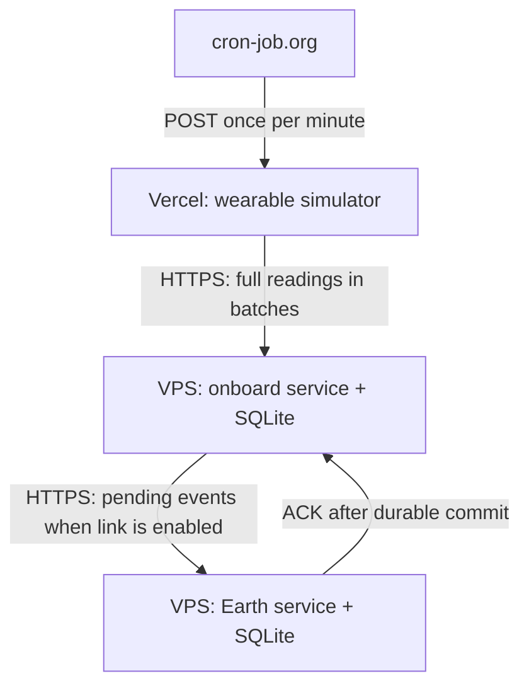

# Space Health Telemetry — Minimal MVP Flow

**Status:** MVP implementation standard  
**Scope:** Synthetic telemetry generation, onboard processing, and delivery to a simulated Earth service.

> **MVP adaptation and integration baseline:** this document defines the reduced, integrable implementation that will be presented in the MVP. It is adapted from the broader architecture proposed in [../infra/telemetry.drawio](../infra/telemetry.drawio) and detailed in [../docs/telemetry-architecture.md](../docs/telemetry-architecture.md). It preserves the core guarantees—local durable ingestion, onboard processing, an outbox, automatic delivery, and durable acknowledgements—while intentionally replacing production-scale components with simpler MVP equivalents.

> The MVP is therefore **not** a replacement for the proposed telemetry architecture. It is a demonstrable integration path that validates its most important behaviors now and can evolve toward BLE, MQTT, Protobuf, PostgreSQL, DELTA/FULL reconstruction, and the other capabilities described in the infrastructure plan.

## 1. Goal

Build the smallest working, integrable system that demonstrates this flow:

1. Generate synthetic wearable health readings.
2. Send them to an onboard service.
3. Store and process them onboard.
4. Forward them to an Earth service when the simulated communication link is available.
5. Confirm durable reception and safely handle retransmission.

There is no physical wearable in this MVP. The onboard and Earth services run in separate Docker containers on the same VPS. Their separation is logical, not geographic.

## 2. Architecture



For the initial implementation, **use HTTP for both communication steps**. Do not add an MQTT broker yet. HTTP is an MVP transport substitution for the MQTT 5/mTLS transport proposed in `infra/telemetry.drawio`; the Outbox and application ACK preserve the delivery behavior we need to demonstrate without another running component.

The simulator package already implements the Vercel sender and includes a development-only onboard mock. The production onboard and Earth services described here still need to be implemented.

## 3. Minimum Components

| Component | Runs on | Responsibility |
| --- | --- | --- |
| External scheduler | cron-job.org | Call the simulator endpoint once per minute |
| Wearable simulator | Vercel, Node.js | Generate deterministic synthetic readings and deliver one bounded batch |
| Onboard service | VPS, Docker, Node.js | Receive readings, persist them, evaluate simple rules, and forward pending events |
| Onboard database | Dedicated Docker volume, SQLite | Store sessions, readings, alerts, and Outbox records |
| Earth service | VPS, Docker, Node.js | Deduplicate and persist incoming events, then return an ACK |
| Earth database | Separate Docker volume, SQLite | Store received events and reception timestamps |
| HTTPS entry point | Existing VPS proxy or one small reverse proxy | Expose authenticated onboard endpoints to Vercel |

Use two application containers and their persistent volumes. Reuse an existing HTTPS proxy if available. Earth does not need a public endpoint; onboard can reach it through the private Docker network.

A frontend, PostgreSQL, Redis, MQTT, Kubernetes, and a separate worker service are not required for the first working version.

## 4. Step-by-Step Flow

### Step 1 — Trigger the simulator

cron-job.org calls:

```http
POST https://<vercel-domain>/api/tick
Authorization: Bearer <CRON_SECRET>
```

The request has no body. Configuration comes from Vercel environment variables. The simulator rejects unauthorized requests and performs no generation when disabled.

### Step 2 — Read the onboard cursor

The simulator queries:

```http
GET https://<onboard-domain>/v1/simulations/{sessionId}/cursor
Authorization: Bearer <ONBOARD_TOKEN>
```

The cursor identifies the next sequence that has not yet been durably received for all devices in the session. The VPS is the source of truth; Vercel stores no persistent session state.

An unknown session returns 404 and starts at sequence zero. A storage failure must return an error, not 404.

### Step 3 — Generate a bounded batch

The simulator generates readings from the persisted cursor up to the eligible simulation time, subject to the configured batch limit.

Initial configuration:

| Setting | Initial value |
| --- | --- |
| Simulated devices | 3 |
| Sampling interval | 1 second per device |
| Scheduler interval | 1 minute |
| Maximum simulated seconds per invocation | 60 |
| Typical full-minute batch | 180 readings |
| Scenario | NORMAL |
| Data source label | SIMULATED |

All readings are generated immediately during the invocation. There is no one-second waiting loop.

Each reading contains a stable sample ID, device ID, boot/session identity, sequence, acquisition timestamp, sensor status, and health metrics. Metrics are heart rate in BPM, SpO₂ in hundredths of a percent, temperature in hundredths of a degree Celsius, and battery voltage in millivolts. Invalid metrics are null, not zero.

The same seed, session, configuration, device, and sequence produce the same reading. Configuration changes that affect generated data require a new session ID.

### Step 4 — Persist onboard and acknowledge

The simulator sends:

```http
POST https://<onboard-domain>/v1/telemetry/batches
Authorization: Bearer <ONBOARD_TOKEN>
Content-Type: application/json
Idempotency-Key: <batchId>
```

The onboard service:

1. Authenticates the sender and validates the contract and sequence range.
2. Checks that the session configuration matches the stored configuration.
3. Opens a database transaction with appropriate session serialization.
4. Inserts new readings, evaluates the initial simple rules, records any alerts, and creates Outbox events.
5. Advances the contiguous cursor.
6. Commits the transaction durably.
7. Returns the agreed ACK containing every accepted sample ID, including identical duplicates.

For this small MVP, rule evaluation is deterministic and lightweight and runs inside this bounded transaction. No separate processing queue is required. If asynchronous jobs are introduced later, they must be persisted in the same transaction before ACK.

The simulator ingestion contract is **all or nothing per batch**. A conflicting or invalid batch is rejected without partially advancing the cursor. Repeated identical samples do not create additional readings or alerts.

### Step 5 — Return a short response to the scheduler

After validating the onboard ACK, Vercel returns a small execution summary, such as delivered count and remaining backlog. It does not return the health readings.

The current sender uses an 18-second shared upstream timeout and a 25-second Function duration limit. It does not continue work in the background after returning a response.

If delivery fails, the invocation returns an error. The next scheduled invocation reads the cursor again and regenerates the outstanding synthetic readings.

### Step 6 — Process the onboard Outbox

A single lightweight worker loop inside the onboard container checks for pending events. Start with a configurable five-second interval and one batch in flight.

The loop:

1. Checks the simulated Earth-link setting.
2. If disabled, leaves events pending without attempting delivery.
3. If enabled, reads up to 100 pending events.
4. Sends them to the Earth service over the private Docker network.
5. Validates the Earth ACK.
6. Marks only confirmed events as synchronized.

Use a bounded request timeout and persist retry scheduling. Failed attempts use backoff with jitter. The first version runs one onboard container/worker; do not scale it horizontally without adding durable work claiming.

### Step 7 — Persist on Earth and acknowledge

The Earth service exposes an internal ingestion endpoint, for example:

```http
POST http://earth-service:3000/v1/events/batches
Authorization: Bearer <EARTH_INGEST_TOKEN>
Content-Type: application/json
```

Earth validates events, deduplicates them by stable event ID, and commits them to its own database before returning accepted IDs. Identical retries receive confirmation again. The same ID with different content is rejected and recorded as a conflict.

Use an atomic batch ACK for this first version as well. The onboard worker only synchronizes the batch after a complete, valid ACK. Keep onboard and Earth databases separate; onboard must not read or write the Earth database directly.

## 5. Minimal Event Contract

The Vercel sender's OpenAPI and JSON Schemas are the source of truth for simulator-to-onboard traffic. Reuse them rather than redefining those payloads in prose.

For onboard-to-Earth traffic, define one small versioned JSON contract before implementation. The first version needs only:

| Field | Purpose |
| --- | --- |
| version | Contract version, initially 1 |
| eventId | Stable identity retained across every retry |
| type | FULL_READING or EXPERIMENTAL_ALERT |
| sessionId | Simulation session |
| sourceSampleId | Original reading identity |
| createdAtOnboardMs | Onboard event creation time |
| dataSource | Always SIMULATED |
| payload | Complete reading or self-contained alert evidence |

The batch adds batchId and events. The ACK adds batchId, persistedAtMs, and acceptedEventIds. Correlate sourceSampleId, eventId, and batchId in technical logs without logging credentials or full health payloads.

The minimal MVP sends **complete readings**. Delta encoding, Protobuf, base recovery, and partial ACKs are deferred. They remain planned extensions from the proposed architecture after the basic delivery path works.

## 6. Simulated Disconnection

Simulate loss of the onboard-to-Earth link while keeping simulator-to-onboard communication available.

A single persisted boolean setting, controlled through an authenticated administration endpoint, is enough initially:

- Link disabled: onboard continues receiving, processing, and storing readings; its Outbox grows.
- Link enabled: the worker resumes forwarding pending events.

This setting represents a communication outage. It does not require disabling the VPS network or stopping either database.

If the entire VPS is unavailable, both services stop. Once it returns, the deterministic simulator can regenerate missing synthetic readings from the recovered cursor. This is not proof of offline storage in a physical wearable.

## 7. Minimum Persistence Model

| Onboard table | Purpose |
| --- | --- |
| simulation_sessions | Immutable configuration hash and contiguous ingestion cursor |
| samples | Original readings with identity and sequence uniqueness |
| alerts | Experimental rule results, unique by source sample and rule version |
| outbox | Stable events, delivery status, attempts, and next retry time |
| settings | Persisted simulated link state |

| Earth table | Purpose |
| --- | --- |
| received_events | Unique event IDs, original content, and Earth reception timestamps |

SQLite files must live on separate persistent Docker volumes, not container writable layers. Use transactions, WAL, and synchronous=FULL; verify durability against the actual host storage. Container restarts must preserve data.

Start with PENDING and SYNCED delivery states. A single worker can safely retry PENDING events after a crash if Earth deduplicates. Add leases and IN_FLIGHT state when introducing concurrent workers, rather than adding them before they are needed.

Do not delete active session cursors or unsynchronized events. Add cleanup of old completed simulation sessions after the first successful end-to-end demonstration, with a defined retention policy.

## 8. Initial Rules and Inspection

Implement one configurable experimental threshold rule and explicit invalid-sensor handling. Record the rule identifier/version and supporting sample. This tests local processing without building a clinical decision engine.

Onboard and Earth may provide authenticated read-only status endpoints showing counts and the latest reception time. A terminal/client HTTP view is enough for the first milestone; a dashboard can follow later.

Onboard processing continues while the Earth link is disabled. However, acquisition is delivered in minute batches, so readings can already be roughly one minute old, plus scheduling and network delay, when they arrive onboard. Do not describe this as second-by-second live monitoring.

## 9. Security Basics

- Use HTTPS for Vercel-to-VPS communication and validate certificates.
- Use distinct secrets for scheduler-to-Vercel, simulator-to-onboard, and onboard-to-Earth.
- Keep secrets in environment configuration and out of source control.
- Expose only the required onboard HTTPS routes publicly; keep Earth and database files private.
- Authenticate control and status endpoints as well as ingestion.
- Validate payload size, shape, identity, and sequence relationships before processing.
- Avoid logging tokens and complete health payloads.

## 10. Failure Behavior

| Failure | Expected behavior |
| --- | --- |
| Scheduler is delayed | Next invocation generates eligible readings from the onboard cursor |
| Simulator request fails before onboard commit | Cursor stays unchanged; readings are regenerated next time |
| Onboard commits but its ACK is lost | Next invocation sees the advanced cursor; no logical duplication |
| Two simulator calls overlap | Onboard transaction and uniqueness constraints prevent duplication or cursor gaps |
| Earth link is disabled | Local ingestion/processing continues; Outbox retains events |
| Earth commits but its ACK is lost | Onboard retries; Earth deduplicates and confirms again |
| Application container restarts | Database survives on its volume; worker resumes pending delivery |
| Persistent storage is lost or full | Report failure; no claim of unlimited retention or zero data loss |

With 60 generated seconds per minute, existing backlog does not shrink at steady state. Set MAX_SECONDS_PER_TICK to 120 when catch-up is required. Likewise, onboard-to-Earth throughput must exceed incoming event generation to drain its backlog.

## 11. What We Intentionally Defer

- Physical wearable integration and BLE.
- MQTT broker and other transport infrastructure.
- Delta compression, Protobuf, and base synchronization.
- Dedicated job queues, Redis, and separate worker containers.
- PostgreSQL/time-series infrastructure and database replication.
- Geographically separated onboard/Earth deployments and high availability.
- Automatic diagnosis or medically validated alert thresholds.
- Continuous second-by-second transmission from Vercel.
- Advanced tracing infrastructure and dashboards.

This document defines the reduced implementation scope and the integration standard for the MVP. The proposed architecture in [../infra/telemetry.drawio](../infra/telemetry.drawio), with its supporting [architecture documentation](../docs/telemetry-architecture.md), remains the reference for future hardening; its MQTT/BLE/DELTA and asynchronous-worker requirements are not mandatory for this first milestone.

## 12. First Milestone — Definition of Done

1. An authenticated cron invocation triggers the Vercel simulator.
2. A batch of synthetic readings is durably received onboard.
3. At least one configured scenario produces an experimental local alert.
4. Readings and alert events reach the Earth service and receive durable ACKs.
5. Disabling the Earth link increases pending events without interrupting onboard ingestion.
6. Re-enabling the link drains pending events.
7. Repeating batches or losing ACKs does not create logical duplicates.
8. Restarting application containers preserves readings and pending events.

**Success means the basic data path works reliably and can be demonstrated. Additional infrastructure is introduced only when a measured requirement calls for it.**
